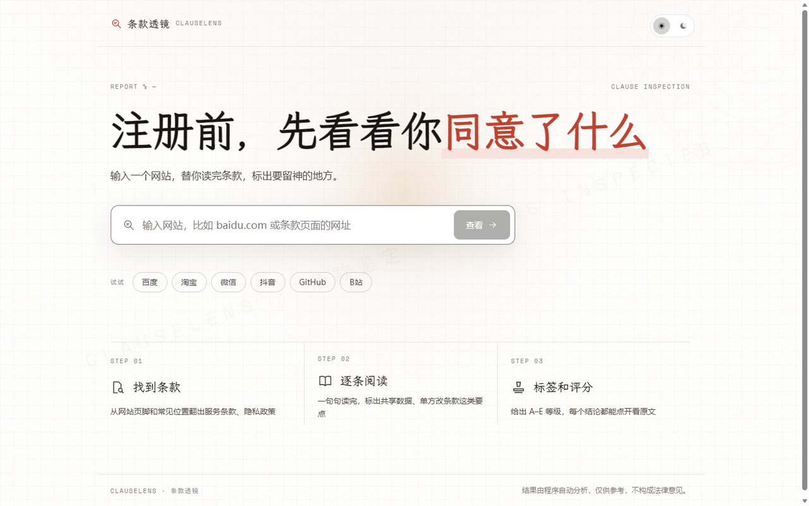
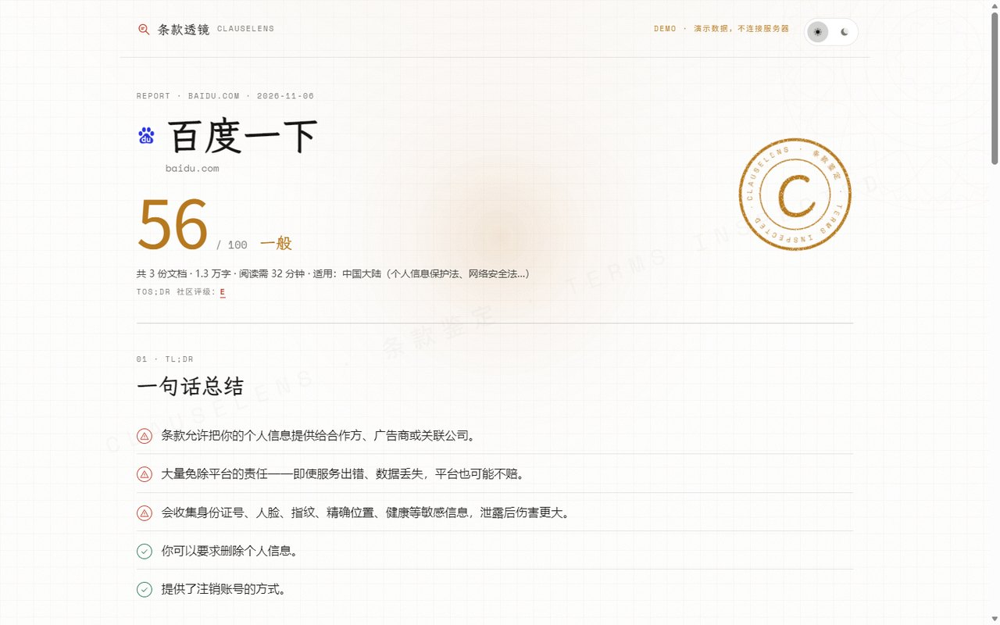
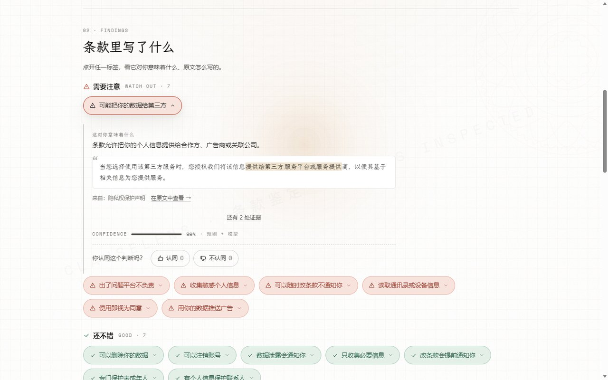
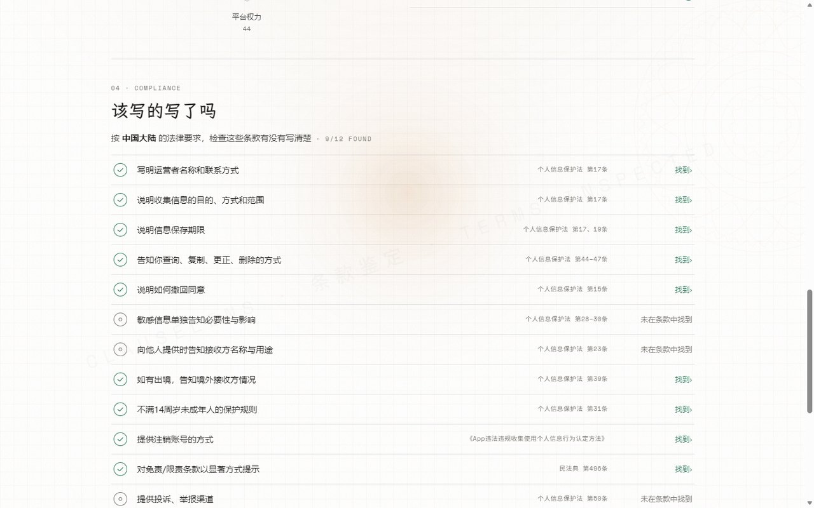
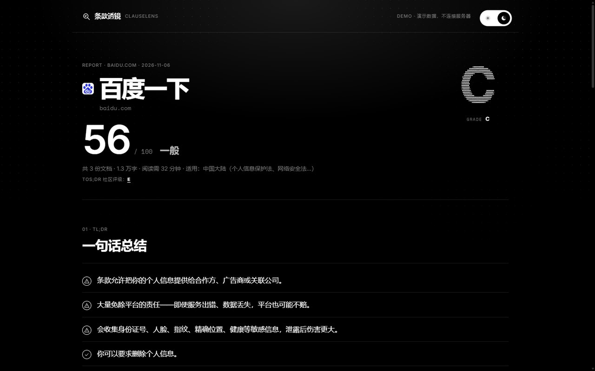
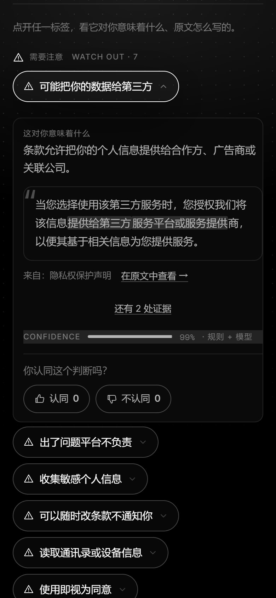

# ClauseLens · 条款透镜

**English · [简体中文](README.md)**

> Before you sign up, see what you just agreed to.

Give it a website (`baidu.com`) or a policy page URL (`https://www.baidu.com/duty/yinsiquan-policy.html`), and ClauseLens finds its privacy policy / terms of service, reads them clause by clause, and returns **an A–E grade + a 0–100 score + tags + verbatim evidence + a jurisdiction-specific checklist**. Readers can also vote *agree* or *disagree* on each tag.

> The result is produced automatically and is for reference only — it is not legal advice.

## Screenshots

<p align="center">
  
  
</p>
<p align="center"><sub>Left: enter a website (or a policy page URL) · Right: grade / score / one-line summary — every conclusion opens the source text</sub></p>

<p align="center">
  
  
</p>
<p align="center"><sub>Left: open a tag = what it means for you + verbatim evidence + agree / disagree (changeable, cancellable) · Right: clause-by-clause checklist of “what should have been stated”</sub></p>

<p align="center">
  
  
</p>
<p align="center"><sub>Left: dark pixel theme (desktop defaults to light; switch manually) · Right: mobile follows the system light/dark setting automatically</sub></p>

<sub>The UI is in Chinese. Screenshots use the bundled sample (`?demo=baidu`) and never touch a server.</sub>

## Quick start (Windows, bash / Git Bash — paste as one block)

```bash
git clone git@github.com:deity6/ClauseLens.git && cd ClauseLens
pip install -r requirements.txt                                              # first run (versions pinned)
cd frontend && npm install && npm run build && cd ..                         # first run, or after frontend changes
python -m uvicorn clauselens.api:app --app-dir backend --port 8787
```

Open <http://localhost:8787>. Offline demo: <http://localhost:8787/?demo=baidu>, `?demo=github`.

Frontend dev mode (hot reload, second terminal): `cd frontend && npm run dev` → <http://localhost:5173> (`/api` is proxied to 8787).

## Query one site from the CLI

No server needed — it prints the verdict straight into the terminal:

```bash
python scripts/query.py baidu.com                    # formatted result
python scripts/query.py github.com --json > out.json # full data (including source text)
python scripts/query.py v2ex.com -v                  # also show the crawling steps
python scripts/query.py bilibili.com --no-cache      # bypass the 24-hour cache
```

Equivalent form (from the `backend/` directory): `python -m clauselens baidu.com`.

To check the success rate over a batch of sites:

```bash
python scripts/probe_sites.py                    # 40 built-in sites
python scripts/probe_sites.py --file mylist.txt  # your own list, one domain per line
```

Exit code 2 on failure, 0 on success — usable in shell scripts.

## How it works

```
input → parse (fuzzy / precise) → find policies (known direct links / home-page link scoring / second hop / common paths)
      → safe fetch (SSRF guards, 5MB / 20s caps) → text extraction → sentence splitting
      → detection: rule layer (CN/EN regex) + model layer (TF-IDF + LR; English trained on ToS;DR, Chinese on human labels), fused
      → scoring: tag penalties calibrated on ToS;DR human grades → 0–100 → A–E; six-dimension radar
      → jurisdiction: TLD / ICP filing / cited statutes → CN/EU/US/UK/... checklist (only “found / not found”)
      → streamed stage by stage over SSE → frontend
```

The 36 tags span 6 dimensions (data collection / data sharing / your rights / platform power / liability & disputes / content ownership); definitions live in
`backend/clauselens/taxonomy.py`; the manual ToS;DR case → tag mapping is in `backend/clauselens/tosdr_map.py`.

## Data (details in `data/processed/CORPUS.md`)

| Source | Size | Use | License |
|---|---|---|---|
| ToS;DR (Zenodo full export + API) | 2,819 sites; 22,497 human-annotated quotes; full terms for 4,960 documents across 2,211 rated sites | English training / site-level evaluation / score calibration | GPL-3.0 (Zenodo) / CC BY-SA (API) |
| Open Terms Archive | 790 services, 2,544 documents | English full-text corpus | ODC-BY 1.0 |
| Self-crawled Chinese sites | 187 sites, 486 documents | Chinese corpus + snapshots of covered sites | original site copyright, research analysis only |
| Human-labelled Chinese sentences (this project) | 2,800 sentences (train 2,000 / dev 400 / test 400) | Chinese training and evaluation | this project |
| CAPP-130 | 130 apps, 38,889 sentences | Chinese topic-level evaluation | CC BY 4.0 |

## Evaluation (every number is produced by a script; see `eval/reports/`)

Splits are always **by site**; test sites never take part in training, threshold tuning or score calibration.

| Evaluation | Data | Result |
|---|---|---|
| English, sentence level (31 tags) | ToS;DR test: 354 sites / 4,154 sentences | micro P **0.77** / R 0.70 / F1 **0.74** (rules only: F1 0.29) |
| Chinese, sentence level (23 tags) | human-labelled test: 27 sites / 330 sentences (leakage removed) | micro P **0.65** / R 0.55 / F1 **0.59** (rules only: F1 0.43) |
| Site grade | ToS;DR test: 443 sites | exact match **50%** (majority-class baseline 43%), within one grade **94%**, Spearman 0.50 |

Reproduce:

```bash
python scripts/train_model.py        # English model + sentence_eval.md (~30s)
python scripts/train_model_zh.py     # Chinese model + zh_model_eval.md (~10s)
python scripts/calibrate_score.py    # score calibration (train sites only, ~5min the first time)
python scripts/eval_sites.py eval    # site-level evaluation (~5min)
python scripts/eval_zh.py test       # Chinese rule layer + CAPP-130 topic level
```

Rebuild the datasets: `scripts/harvest_tosdr.py`, `scripts/build_dataset.py`, `scripts/harvest_cn.py`, `scripts/build_ota.py`, `scripts/build_registry.py`.

## Repository layout

See `AGENTS.md` (project overview, sub-agent roles, review checklist, red lines). Interface contract: `docs/design/contract.md`.
Research: `docs/research/`. Review reports: `docs/reviews/`. Progress log: `docs/PROGRESS.md`.

## Behind a restrictive network (optional egress)

Direct connections by default. But some domains are DNS-poisoned locally (`signal.org` resolves to `31.13.90.33`,
`duckduckgo.com` to `108.160.169.175`), or TCP is reset right after the SNI handshake — those pages never load
and you only get “cannot connect”.

An overseas egress rescues exactly those cases; successful direct fetches **never** go through it:

```powershell
# 1) Borrow an overseas cloud container's exec to run curl — no published port, no daemon
$env:CLAUSELENS_EGRESS = "cloud:<machine-id>"

# 2) Or bring up your own SOCKS tunnel (must be socks5h, so the remote side resolves DNS)
ssh -D 127.0.0.1:1080 -N <your-overseas-host>
$env:CLAUSELENS_EGRESS = "socks5h://127.0.0.1:1080"
```

See `.env.example`. A page fetched through the egress takes about 2–9 s (one extra round trip), so it is only
triggered after a direct failure — and later requests to the same domain remember that failure and go straight
to the egress instead of waiting on the timeout again.

## Known limitations

- Some overseas sites (google.com, x.com, …) are unreachable from the current network and report “cannot connect” — configure an egress to read them;
  JS-rendered sites that are not in the registry may yield no policy; you can paste the policy URL directly.
- The grade agrees with ToS;DR community ratings about half the time; most of the error is the A/B and E ends being compressed into C/D — treat it as a **signal**, not a verdict.
- The Chinese model was trained on only 2,000 sentences; low-frequency tags (arbitration, class actions, “final interpretation right”) rely mainly on rules.

## Deployment

| | |
|---|---|
| Site | <https://lens.dohub.tech> |
| Frontend | Cloudflare Pages (`frontend/dist`); `/api/*` is same-origin proxied by a Pages Function |
| Backend | A 2 vCPU / 2 GB AWS server, systemd `clauselens.service`, Caddy on 443 reverse-proxying to `127.0.0.1:8787` |
| Repository | <https://github.com/deity6/ClauseLens> |

Architecture:

```
browser → lens.dohub.tech (CF Pages)
            └ /api/* → functions/api/[[path]].js → https://api.dohub.tech (Caddy → uvicorn)
```

### Operations

```bash
# Update the backend (the box is not a git checkout — copy the file)
scp backend/clauselens/api.py <host-alias>:~/clauselens/backend/clauselens/api.py
ssh <host-alias> "sudo systemctl restart clauselens && systemctl is-active clauselens"

# Logs / memory
ssh <host-alias> "journalctl -u clauselens -f"
ssh <host-alias> "free -m; systemctl show clauselens -p MemoryCurrent --value"

# Update the frontend (local) — theme / animation / lens changes only need this step
cd frontend && npm run build && npx wrangler pages deploy dist --project-name clauselens --branch master

# Note: the Pages project is a direct upload, not connected to Git — a git push does NOT go live;
# the command above is what updates production (the lens.dohub.tech custom domain follows the canonical deployment).
# No global wrangler? Use npx.
```

### Run the production build locally (same shape as CF Pages)

For theme / animation work, don't judge from `npm run dev` alone: dev runs the source with hot reload and is not
necessarily isomorphic to the production bundle. Spin up a minimal local copy of “build output + `/api` reverse proxy”:

```powershell
cd frontend
$env:CLAUSELENS_API = 'https://api.dohub.tech'   # unset => points at local 8787
npm run local                                     # = vite build && vite preview --host 127.0.0.1
# open http://127.0.0.1:4173
```

- `server.proxy` / `preview.proxy` in `vite.config.js` both read `CLAUSELENS_API`; one env var switches the backend.
- Offline demo (no backend): `http://127.0.0.1:4173/?demo=baidu`, `?demo=github`.
- Theme debugging: the switch in the top-right toggles light ⇄ dark; the choice is stored in `localStorage['cl:theme']`. Screenshot script:
  `node scripts/shot.mjs <url> <out.png> --theme=geek` (see `scripts/`).

### Two themes

| | Light — paper (default) | Dark — pixel palette (`data-theme="geek"`) |
|---|---|---|
| Character | Inspection report, warm paper background + LXGW WenKai | Black + white contrast (Quiet Dark): large type, 1px hairlines, white accent |
| Background | 24px grid + icon-ring guilloche + warm glow + noise | A 22px dot band at the top (first screen only, not tiled) + a dotted ridge in the footer |
| Type | Kai-style headings / Instrument Serif numbers / Space Mono labels | Inter (self-hosted) + system Chinese sans; monospace only for machine readouts |
| Grade badge | Round grade stamp in the grade colour | ASCII dot letters: the grade letter drawn in dots; characters pop up as the cursor passes |
| Switching | — | Top-right segmented switch; 4px pixel grid + “pixel curtain” transition |

Implementation notes live in `docs/design/theme-geek.md`. Frame-by-frame look at the transition:

```powershell
node scripts/wipe-frames.mjs 'http://127.0.0.1:4173/' out/shots/wipe --from=light --to=geek
```

### Known gaps

- `CLAUSELENS_EGRESS` is not configured: blocked sites report “cannot connect”. To enable it, add
  `Environment=CLAUSELENS_EGRESS=instabox:<machine-id>` to the systemd unit
- Rendering only kicks in when “body text < 400 chars”, and at most 3 pages per analysis

## Live site

<https://lens.dohub.tech> — frontend on Cloudflare Pages; the backend is the author's own small box, so it may be
offline at any time. When it is, use the demo build or run it locally.

## License and data sources

- Code: **MIT**, see [LICENSE](LICENSE).
  MIT has exactly one obligation: **keep the copyright notice and the full license text when you redistribute
  the code or a build artifact**.
- Some components and their licenses: [THIRD-PARTY-NOTICES.md](THIRD-PARTY-NOTICES.md)
- The tag taxonomy draws on ToS;DR (the CC BY-SA 4.0 parts are noted in `docs/research/`). Sample terms are demo-only:
  `frontend/src/data/sample-baidu.json` / `sample-github.json` are excerpts of those sites' own terms.
- The Chinese labelling guide and split files (`data/processed/`) ship with the repository under the same license.

## Privacy

- No accounts, no cookies, no tracking beyond a third-party-free analytics script.
- A vote stores only `domain / tag_id / vote / at` plus an `ip_hash` (`sha1(server-side random salt | IP)[:12]`; the salt is not published with the code).
  It is used solely for one-vote-per-tag deduplication and rate limiting; **no IP is stored**. If you would rather not leave that record, please don't vote.