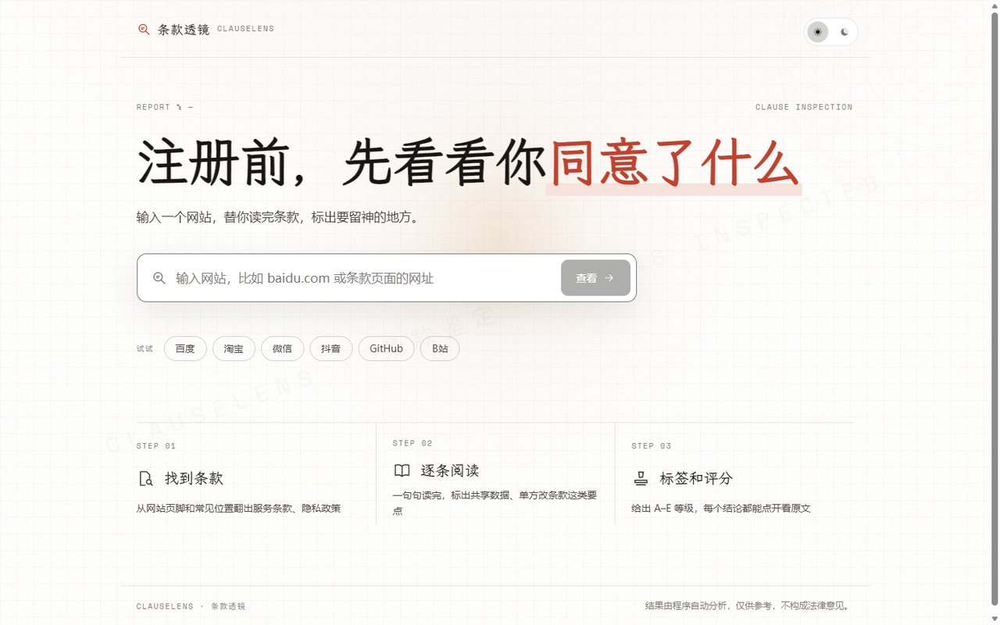
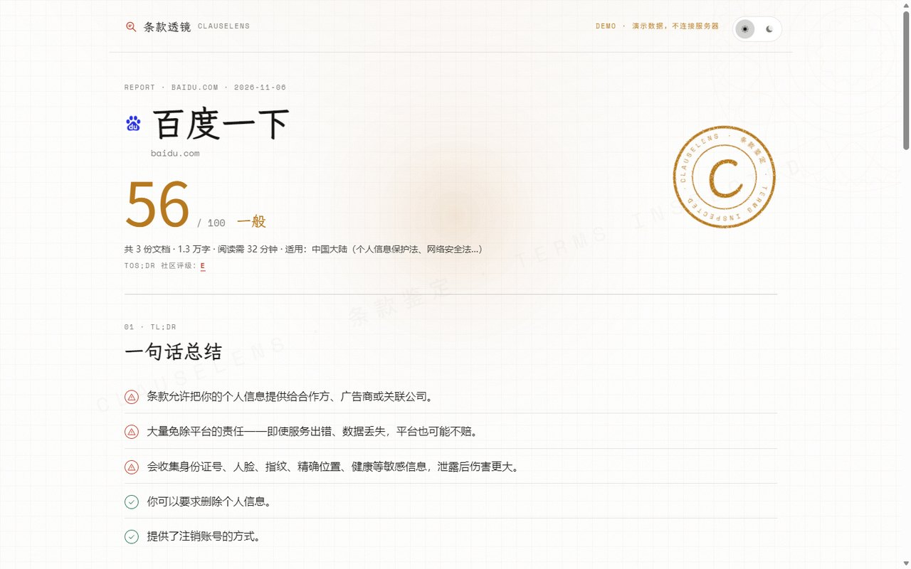
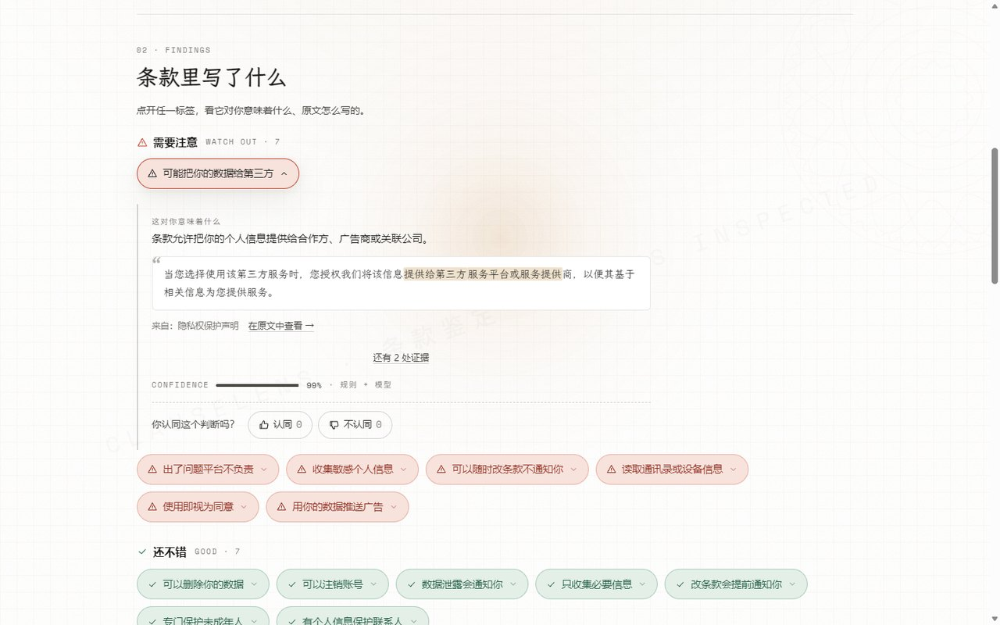
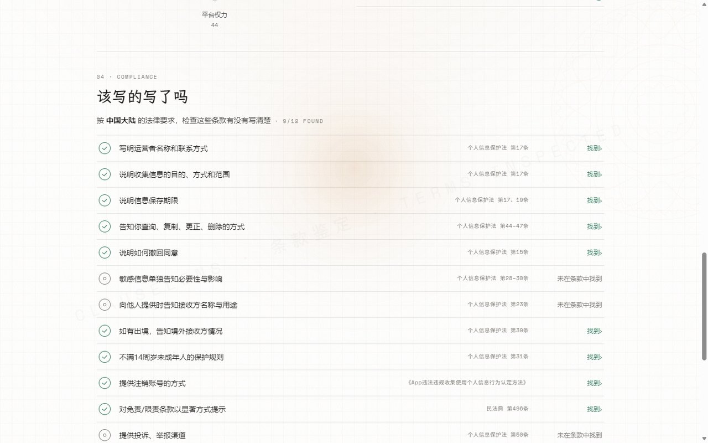
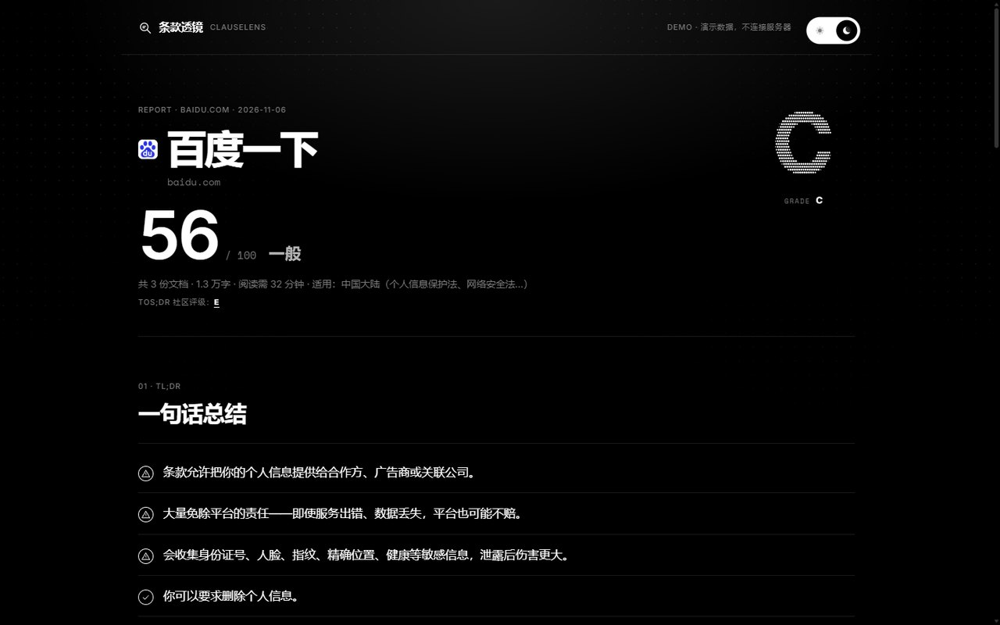
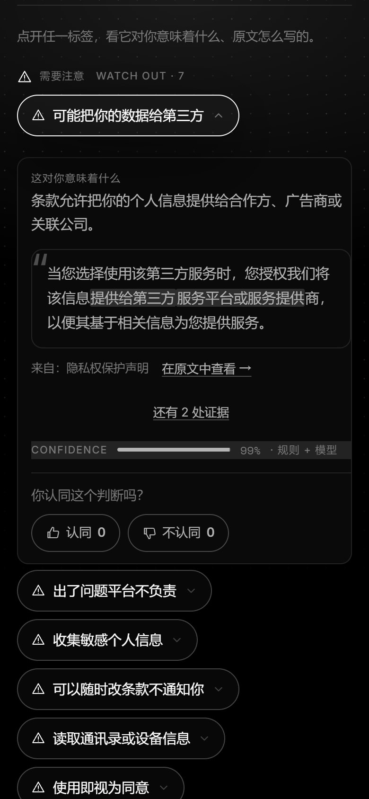

# ClauseLens 条款透镜

> 注册前，先看看你同意了什么。

输入一个网站（`baidu.com`）或条款页面网址（`https://www.baidu.com/duty/yinsiquan-policy.html`），
ClauseLens 会找到它的隐私政策 / 用户协议，逐条阅读，给出 **A–E 等级 + 0–100 分 + 标签 + 原文证据 + 所在法域的必备项检查**，
用户还可以对每个标签投「认同 / 不认同」。

> 结果由程序自动分析，仅供参考，不构成法律意见。

## 长什么样

<p align="center">
  
  
</p>
<p align="center"><sub>左：输入一个网站（或条款页网址） · 右：等级 / 分数 / 一句话总结，每个结论都能点开看原文</sub></p>

<p align="center">
  
  
</p>
<p align="center"><sub>左：点开标签 = 这对你意味着什么 + 原文证据 + 认同 / 不认同（可改可撤） · 右：按法域逐条检查「该写的写了吗」</sub></p>

<p align="center">
  
  
</p>
<p align="center"><sub>左：点阵主题（桌面默认浅色，手动切换） · 右：手机端自动跟随系统深浅色</sub></p>

<sub>截图里的数据来自内置示例（`?demo=baidu`），不连服务器。</sub>

## 快速开始（Windows，bash / Git Bash，整块粘贴）

```bash
git clone git@github.com:deity6/ClauseLens.git && cd ClauseLens
pip install -r requirements.txt                                              # 首次（版本已锁）
cd frontend && npm install && npm run build && cd ..                         # 首次或改前端后
python -m uvicorn clauselens.api:app --app-dir backend --port 8787
```

浏览器打开 <http://localhost:8787>。离线演示：<http://localhost:8787/?demo=baidu>、`?demo=github`。

前端开发模式（热更新，另开一个终端）：`cd frontend && npm run dev` → <http://localhost:5173>（`/api` 自动代理到 8787）。

## 命令行查单个站点

不起服务也能查，直接在终端出结论：

```bash
python scripts/query.py baidu.com                    # 排版好的结果
python scripts/query.py github.com --json > out.json # 完整数据（含原文）
python scripts/query.py v2ex.com -v                  # 同时显示抓取过程
python scripts/query.py bilibili.com --no-cache      # 绕过 24 小时缓存
```

等价写法（在 `backend/` 目录下）：`python -m clauselens baidu.com`。

想知道一批站点的成功率：

```bash
python scripts/probe_sites.py                    # 内置 40 个站
python scripts/probe_sites.py --file mylist.txt  # 自己列，每行一个域名
```

失败时退出码 2，成功 0——可以接进 shell 脚本。

## 它是怎么工作的

```
输入 → 解析(模糊/精准) → 发现条款(已收录直链 / 首页链接打分 / 二跳 / 常见路径)
     → 安全抓取(SSRF 防护, 5MB/20s 上限) → 正文提取 → 分句
     → 识别：规则层(中英正则) + 模型层(TF-IDF+LR，英文用 ToS;DR 标注、中文用人工标注) 融合
     → 评分：在 ToS;DR 人工等级上标定的标签惩罚 → 0–100 → A–E；六维雷达分
     → 法域：TLD / ICP 备案 / 引用法律 → CN/EU/US/UK/... 必备项检查(只报“找到/未找到”)
     → SSE 逐阶段推送 → 前端
```

36 个标签分 6 个维度（隐私收集 / 数据共享 / 你的权利 / 平台权力 / 责任与纠纷 / 内容归属），定义见
`backend/clauselens/taxonomy.py`；ToS;DR case → 标签的人工映射见 `backend/clauselens/tosdr_map.py`。

## 数据（详见 `data/processed/CORPUS.md`）

| 来源 | 规模 | 用途 | 许可 |
|---|---|---|---|
| ToS;DR（Zenodo 整库导出 + API） | 2,819 站点；22,497 条人工标注原文引用；2,211 个有评级站点的 4,960 份条款全文 | 英文训练 / 站点级评测 / 评分标定 | GPL-3.0（Zenodo）/ CC BY-SA（API） |
| Open Terms Archive | 790 服务、2,544 份文档 | 英文全文语料 | ODC-BY 1.0 |
| 自抓中文站点 | 187 站、486 份文档 | 中文语料 + 已收录站点快照 | 原站版权，仅研究分析 |
| 人工标注中文句（本项目） | 2,800 句（train 2,000 / dev 400 / test 400） | 中文训练与评测 | 本项目 |
| CAPP-130 | 130 App、38,889 句 | 中文主题级评测 | CC BY 4.0 |

## 评测（全部由脚本生成，见 `eval/reports/`）

划分一律**按站点**，test 站点从不参与训练、调阈值或评分标定。

| 评测 | 数据 | 结果 |
|---|---|---|
| 英文句子级（31 标签） | ToS;DR test：354 站 / 4,154 句 | micro P **0.77** / R 0.70 / F1 **0.74**（仅规则 F1 0.29） |
| 中文句子级（23 标签） | 人工标注 test：27 站 / 330 句（已去泄漏） | micro P **0.65** / R 0.55 / F1 **0.59**（仅规则 F1 0.43） |
| 站点等级 | ToS;DR test：443 站 | 完全一致 **50%**（多数类基线 43%），相差≤1 级 **94%**，Spearman 0.50 |

复跑：

```bash
python scripts/train_model.py        # 英文模型 + sentence_eval.md（~30s）
python scripts/train_model_zh.py     # 中文模型 + zh_model_eval.md（~10s）
python scripts/calibrate_score.py    # 评分标定（只用 train 站点，首次 ~5min）
python scripts/eval_sites.py eval    # 站点级评测（~5min）
python scripts/eval_zh.py test       # 中文规则层 + CAPP-130 主题级
```

数据重建：`scripts/harvest_tosdr.py`、`scripts/build_dataset.py`、`scripts/harvest_cn.py`、`scripts/build_ota.py`、`scripts/build_registry.py`。

## 目录

见 `AGENTS.md`（项目总纲、子代理分工、审查清单、红线）。接口契约：`docs/design/contract.md`。
调研：`docs/research/`。审查报告：`docs/reviews/`。进度：`docs/PROGRESS.md`。

## 网络受限怎么办（可选出口）

默认是纯直连。但有些站点的域名在本机被 DNS 污染（`signal.org` 解析到 `31.13.90.33`、
`duckduckgo.com` 解析到 `108.160.169.175`），或者 TCP 建连后被 SNI 阻断，直连永远拿不到内容，
只会报「连不上」。

配一个境外出口就能救回来，直连**成功时完全不经过它**：

```powershell
# 1) 借 InstaBox 云容器的 exec 跑 curl —— 不发布端口、无常驻进程
$env:CLAUSELENS_EGRESS = "instabox:<machine-id>"

# 2) 或者自己起一个 SOCKS 隧道（必须是 socks5h，让远端解析域名）
ssh -D 127.0.0.1:1080 -N <your-overseas-host>
$env:CLAUSELENS_EGRESS = "socks5h://127.0.0.1:1080"
```

见 `.env.example`。走出口的页面单次约 2–9 秒（多一次往返），所以只在直连失败时触发，
并且同域名的后续请求会记住这次失败、直接走出口，不再每次白等连接超时。

## 已知局限

- 部分海外站点（google.com、x.com 等）从当前网络不可达，会提示「连不上」——配了出口才能读；
  脚本渲染且未收录的站点可能找不到条款，可直接粘贴条款网址。
- 等级只与 ToS;DR 社区评级一致约一半，主要误差是 A/B 与 E 两端被压到 C/D；当作「参考信号」而非结论。
- 中文模型训练集只有 2,000 句，低频标签（仲裁、集体诉讼、最终解释权）主要靠规则。

## 线上部署

| | |
|---|---|
| 站点 | <https://lens.dohub.tech> |
| 前端 | Cloudflare Pages（`frontend/dist`），`/api/*` 由 Pages Function 同源代理 |
| 后端 | AWS 新加坡 t3.micro，systemd `clauselens.service`，Caddy 443 反代到 `127.0.0.1:8787` |
| 仓库 | <https://github.com/deity6/ClauseLens>（私有） |

架构：

```
浏览器 → lens.dohub.tech (CF Pages)
            └ /api/* → functions/api/[[path]].js → https://api.dohub.tech (Caddy → uvicorn)
```

### 运维

```bash
# 更新后端代码（机器上不是 git checkout，直接传文件）
scp backend/clauselens/api.py <主机别名>:~/clauselens/backend/clauselens/api.py
ssh <主机别名> "sudo systemctl restart clauselens && systemctl is-active clauselens"

# 看日志 / 内存
ssh <主机别名> "journalctl -u clauselens -f"
ssh <主机别名> "free -m; systemctl show clauselens -p MemoryCurrent --value"

# 更新前端（本地）——改主题/动效/透镜这类前端改动只需要这一步
cd frontend && npm run build && npx wrangler pages deploy dist --project-name clauselens --branch master

# 说明：Pages 项目是 direct upload，没有接 Git —— git push 不会自动上线；
# 跑上面这条才会更新 production（自定义域 lens.dohub.tech 自动跟随 canonical deployment）。
# 只想部署、不想装 wrangler 全局：用 npx（本机已缓存 wrangler@3.114.0）。
```

### 本地跑「线上版本」（与 CF Pages 同构）

改主题/动效时不要只在 `npm run dev` 里看：dev 走的是源码热更新，和线上产物不一定同构。
本地起一份「构建产物 + `/api` 反向代理」的最小副本，就等于在跑 Pages：

```powershell
cd frontend
$env:CLAUSELENS_API = 'https://api.dohub.tech'   # 不设则指向本机 8787
npm run local                                     # = vite build && vite preview --host 127.0.0.1
# 打开 http://127.0.0.1:4173
```

- `vite.config.js` 里 `server.proxy` / `preview.proxy` 都读 `CLAUSELENS_API`，改一个环境变量就切换后端。
- 离线演示（不连后端）：`http://127.0.0.1:4173/?demo=baidu`、`?demo=github`。
- 主题调试：右上角开关切 纸 ⇄ 点阵，选择记在 `localStorage['cl:theme']`；截图脚本
  `node scripts/shot.mjs <url> <out.png> --theme=geek`（见 `scripts/`）。

### 两套主题

| | 纸（默认，`<html>` 上不写 data-theme） | 点阵（`data-theme="geek"`） |
|---|---|---|
| 气质 | 验光单 / 鉴定报告，暖纸 + 霞鹜文楷 | 纯黑 + 白（Quiet Dark）：大字、1px 发丝线、只有一个“白色强调” |
| 背景 | 24px 网格 + 防伪花环 + 暖色光晕 + 噪点 | 顶部一段 22px 点阵（bencho `hero-dots` 移植，只铺首屏、不铺满）＋ 页脚点阵山脊 |
| 字体 | 楷体标题 / Instrument Serif 数字 / Space Mono 标签 | Inter（自托管）+ 系统中文黑体，等宽只留机器读数 |
| 评分徽章 | 圆形钢印（等级色） | ASCII 点阵屏：等级字母用圆点画出来，鼠标扫过会冒字符（`ascii.txt` 的 ASCIIWake，MIT） |
| 切换 | — | 右上角分段开关；4px 像素格 + Bayer 抖动的「像素落幕」转场（lm-detector 的 `bayer4`/`blocks`） |

实现与来源都写在 `docs/design/theme-geek.md`；调研（哪段代码从哪个仓库搬的、参数是多少）在
`docs/design/theme-geek-refs.md` 与 `out/ref/refs-2.md`。看转场逐帧：

```powershell
node scripts/wipe-frames.mjs 'http://127.0.0.1:4173/' out/shots/wipe --from=light --to=geek
```

### 资源限制（908 MB 机器上的取舍）

- `MemoryHigh=600M` / `MemoryMax=750M`（systemd），超了自动重启而不是拖垮整机
- 分析并发 `BoundedSemaphore(3)`，超过的直接返回 `busy`
- 渲染器 Chromium 用 `--single-process`（实测 480 MB → 280 MB），崩了自动退回多进程重试
- 请求体上限 256 KB（Caddy）

### 已知缺口

- 服务器**没有装 playwright** 之前的状态已修（现在装了，`~/.cache/ms-playwright`）
- 未配置 `CLAUSELENS_EGRESS`：被墙站点会报「连不上」。要开就在 systemd unit 里加
  `Environment=CLAUSELENS_EGRESS=instabox:<machine-id>`
- 渲染只覆盖「正文 < 400 字才触发」，且一次分析最多 3 页

## 在线站点

<https://lens.dohub.tech>（前端 Cloudflare Pages；后端是作者自己的小机器，随时可能离线，离线时用下面的 demo 包或本地跑）。

## 许可与数据来源

- 代码：**MIT**，见 [LICENSE](LICENSE)。
  MIT 的义务只有一条：**再分发代码或构建产物时，保留版权声明与许可全文**（`LICENSE` 跟着走就行）；
  它不要求在网页界面上显著署名（那是 CC BY 那类协议的要求）。
- 第三方组件、网页字体与借鉴实现的许可：见 [THIRD-PARTY-NOTICES.md](THIRD-PARTY-NOTICES.md)
  （React / motion 为 MIT；Inter / Instrument Serif / Space Mono / Noto Sans SC / 霞鹜文楷为 OFL-1.1，全文随仓库附带）。
- 标签体系参考 ToS;DR（CC BY-SA 4.0 的部分见 `docs/research/`）；条款样本只用于演示：
  `frontend/src/data/sample-baidu.json` / `sample-github.json` 是各自站点条款的原文摘录，
  版权归原站（GitHub 条款本文按 CC0 发布；百度条款仅作离线演示，不作再分发用途）。
- 中文标注指南与划分文件（`data/processed/`）随仓库一起发布，同一许可。

## 隐私

- 站点不做账号、不写 cookie、不接第三方统计脚本以外的追踪；页面浏览统计用 Cloudflare Web Analytics（无 cookie）。
- 投票只存 `domain / tag_id / vote / at` 与 `ip_hash`（`sha1(服务端随机盐 | IP)[:12]`，盐不随代码发布），
  用途仅限「一人一标签一票」去重与限流；**不保存明文 IP**。如果你不希望留下这条记录，请不要投票。
