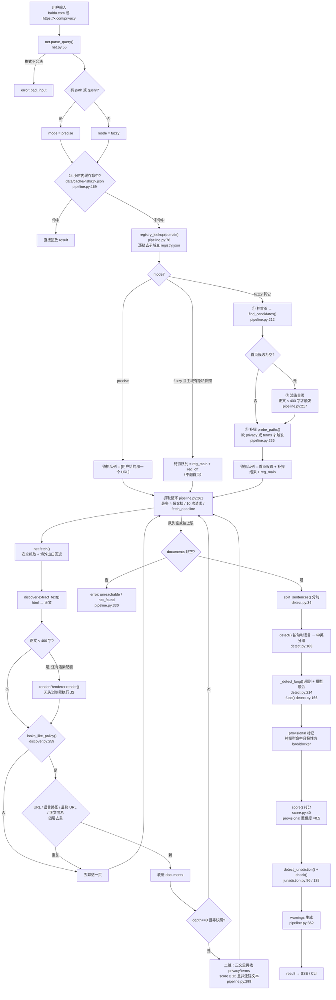

# 抓取与判定流程（与代码逐段对应）

> 这份文档描述**当前代码实际怎么跑**，每个节点都标了 `文件:行号`，行号会随改动漂移，
> 但函数名和判据不会。发现文档和代码不一致时，以代码为准，并回来改这份文档。
>
> 上一版 `AGENTS.md` §3 里的流水线表（`query.py` / `fetch.py` / `extract.py` / `segment.py`）
> 是**早期设计稿，那些文件从来不存在**，已按本文档更正。

## 1. 总流程



## 2. 文字版（同一个流程，终端里看）

```
输入
 └─ net.parse_query()                      net.py:55
      有 path/query → precise；否则 fuzzy；domain 去掉 www.

 └─ 缓存                                  pipeline.py:169
      sha1("mode|url或domain")[:16] → data/cache/*.json，TTL 24h

 └─ registry 查找                          pipeline.py:78
      从 domain 开始逐级去掉最左一段子域，直到命中 5072 条里的某一条
      → 主域文档 reg_main ／ 子域文档 reg_off（后者只作兜底）

 └─ 决定待抓队列（三条岔路）                pipeline.py:204–249
      precise          → [用户给的 URL]
      fuzzy+主域有隐私快照 → reg_main + reg_off（省一次首页往返）
      fuzzy 其它        → 抓首页 → 找链接 → 补探

 └─ 抓取循环                              pipeline.py:261
      最多 4 份文档 / 10 次请求 / fetch_deadline 秒
      每页：fetch → extract_text → [空壳则渲染] → looks_like_policy → 四层去重 → 收
      每页（depth 0 且非快照）：二跳，从正文里再找隐私政策/用户协议

 └─ 分句 → 识别 → 打分 → 法域 → 提示 → result
```

## 3. 逐段说明与代码对照

| 阶段 | 代码 | 判据 / 关键常量 |
|---|---|---|
| 解析输入 | `net.parse_query()` `net.py:55` | `_DOMAIN_RE` 必须有 TLD；`precise = path 非空 or 有 query`；`www.` 从 domain 剥掉但 URL 保留 |
| 缓存 | `pipeline.py:169` | `CACHE_TTL = 24h`；key 含 mode，所以 `baidu.com` 和 `https://baidu.com/x` 是两个缓存 |
| registry | `pipeline.py:78` | 逐级去子域；`data/processed/registry.json` 5,072 条 |
| 首页发现 | `discover.find_candidates()` `discover.py:164` | 遍历 `<a>`，跳过 `javascript:/mailto:/#/tel:`；跨域 −3；每类最多 2 个，总数最多 6 |
| 链接打分 | `discover.classify_link()` `discover.py:147` | privacy 10 / terms 9 / cookie 5 / other 3；锚文本命中 +3；锚文本 > 40 字（段落提及）−6 |
| 兄弟路径 | `discover.sibling_paths()` `discover.py:39` | 从 `/about/copyright.html` 推 `/about/privacy.html` 等；保留原扩展名 |
| 补探 | `discover.probe_paths()` `discover.py:77` | 34 条 `COMMON_PATHS`；6 并发；正文头部去重；>3MB 跳过；`limit` 无候选 24 / 有候选 14；`deadline` ≤14 秒且 ≤ 剩余预算 40% |
| 空壳渲染（首页） | `pipeline.py:217` | 首页候选为空 **且** 正文 < 400 字 **且** 渲染配额未用完 **且** 剩余 > 12 秒 |
| 空壳渲染（正文页） | `pipeline.py:280` | 正文 < 400 字（同上条件） |
| 渲染器 | `render.Renderer` `render.py:63` | 用系统 Edge（`channel="msedge"`）；一次分析复用同一浏览器；最多 3 页；图片/媒体/字体不加载；超时受剩余预算约束 |
| 安全抓取 | `net.fetch()` `net.py:233` | 5MB 上限；单页 20 秒；`_DeadlineKiller` 强制断 socket；连接后校验对端 IP（防 DNS 重绑定）；失败按 `CLAUSELENS_EGRESS` 回退 |
| 正文提取 | `discover.extract_text()` `discover.py:213` | 优先 `article/main`，太短退回 `body`；`<noscript>` 里正文更全时用它；>400KB 先正则剥 script |
| 条款判据 | `discover.looks_like_policy()` `discover.py:259` | ≥150 字；<600 字时要求每 150 字至少 1 个关键词且总数 ≥4；≥600 字要求 ≥8 个 |
| 去重 | `pipeline.py:266–316` | ①请求 URL ②语言路径段（`/zh/` 与 `/en/` 同一份）③跟随重定向后的最终 URL ④正文前 5000 字 sha1 |
| 二跳 | `pipeline.py:299` | `depth == 0`、非快照、`score ≥ 12`、`doc_type ∈ {privacy, terms}`、非「点击此处」类泛锚文本 |
| 分句 | `detect.split_sentences()` `detect.py:34` | 句长 8–1200 字；按 `。！？；!?` 与换行切 |
| 语言判定 | `detect.is_zh()` `detect.py:26` | CJK 字符占比 > 15% 判中文；**按句判**，不按整批 |
| 规则层 | `detect.rule_scores()` `detect.py:85` | 每个标签的正则命中条数；命中 `neg_*` 则否决 |
| 模型层 | `detect.get_model()` `detect.py:119` | `data/models/clause_model.pkl`（英）/ `clause_model_zh.pkl`（中） |
| 融合 | `detect.fuse()` `detect.py:166` | 规则命中 0.55+0.15n（上限 0.85）；模型 p ≥ max(阈值, 0.6) 可独立命中；两者都有 → `rule+model` |
| 模型门槛 | `detect._model_worthy()` `detect.py:138` | 纯模型命中的句子要够长、不含异语言字符、不像标题/导航 |
| 待确认 | `detect.py:183` 末尾 | 来源只有 `model` 且极性 bad/blocker → `provisional=True` |
| 打分 | `score.score()` `score.py:40` | 有 `score_params.json` 用学到的惩罚 + 分段映射；否则维度加权平均 |
| 法域 | `jurisdiction.detect_jurisdiction()` `jurisdiction.py:96` | TLD + ICP 备案 + 引用法律；返回 (code, basis) |
| 合规检查 | `jurisdiction.check()` `jurisdiction.py:128` | 每项只输出「找到 / 未找到 / 不清楚」，不断言违法 |
| 提示 | `pipeline.py:362` | 正文 < 2500 字 → `thin_docs`；无标签 → `no_tags`；有效标签 < 2 → `few_tags` |

## 4. 五种真实输入，各自走哪条路

下面都来自实测，耗时是走境外出口的情况（纯直连会快些）。

### A. 大站 + 已有正文快照：`bilibili.com`

```
parse_query → fuzzy
registry 命中 bilibili.com，主域有隐私政策快照
  → 走「fuzzy+主域有隐私快照」岔路，跳过首页
  → 直接用快照（4769 字）
shows: documents=1 tags=11 D 51，耗时 ~2.4s
```

关键：registry 里 `snapshot` 字段存了抓取时的正文，省掉一次网络往返。

### B. 首页有正常链接：`baidu.com`

```
parse_query → fuzzy
registry 有 baidu.com，但收的是子域产品（百度地图开放平台、手机卫士）→ 全进 reg_off
  → 走主线：抓首页 722KB
  → find_candidates 只找到 1 个：「使用百度前必读」/duty（other，score 3）
  → 补探：缺 privacy/terms，兄弟路径 + COMMON_PATHS，但都 404
  → 抓 /duty → 二跳找到「隐私权保护声明」(score 13)
shows: documents=3 tags=16 C 57
```

关键：`reg_off` 只在首页零候选时才用，所以不会拿手机卫士的协议冒充百度。

### C. 纯前端路由 SPA：`cloud.doulor.cn`

```
parse_query → fuzzy
`/`、`/terms`、`/privacy` 三个地址服务端都返回同一份 13,644 字节 HTML
  → 首页正文 12 字 → 触发渲染 → 1,949 字，找到 2 个链接
  → 每个链接静态也只有 7 字 → 各渲染一次
shows: documents=2（1,271 + 5,024 字）C 60，耗时 ~38s
```

关键：渲染器在整个分析里复用同一个浏览器，否则三次渲染光启动就吃掉预算。

### D. 用户直接给条款页：`https://www.dnsneko.com/privacy`

```
parse_query → precise（有 /privacy 路径）
  → 待抓队列只有这一个 URL，不翻首页
  → 静态 2,609 字节、正文 0 字 → 渲染 → 492 字
  → looks_like_policy(492) → 新判据通过（旧判据 600 字会毙掉）
shows: documents=1 tags=? C 63
```

关键：精确模式仍然会二跳（如果这一页里还有别的条款链接），但不会再回首页找。

### E. 被墙站点：`signal.org`

```
parse_query → fuzzy
抓 https://signal.org/ → 本机 DNS 被污染（解析到 31.13.90.33，Facebook 的 IP）→ 连接失败
  → net.fetch 捕获 fetch_failed → 按 CLAUSELENS_EGRESS=instabox:<id> 走出口
  → 远端 curl 抓回，gzip+base64 传回
  → 首页发现 /legal/ → 抓取
shows: documents=1（13,121 字）C 69，耗时 ~48s
```

关键：某个域名直连失败过一次后会记进 `_EGRESS_HINTS`，同一次分析里后续请求直接走出口，不再每次白等 6 秒连接超时。

## 5. 阈值速查（都能 grep 到）

| 常量 | 值 | 位置 |
|---|---|---|
| `MAX_BYTES` | 5 MB | `net.py:20` |
| `TIMEOUT` | (连接 6s, 读取 10s) | `net.py:21` |
| `TOTAL_TIMEOUT` | 20s / 页 | `net.py:22` |
| `ALLOWED_PORTS` | 80 / 443 / 8080 / 8443 | `net.py:23` |
| `EGRESS_HINT_TTL` | 6 小时 | `net.py:35` |
| `COMMON_PATHS` | 34 条 | `discover.py:20` |
| `SIBLING_STEMS` | 10 个文件名 | `discover.py:35` |
| `MAX_RENDERS` | 3 页 / 次分析 | `render.py:18` |
| `RENDER_TIMEOUT_MS` | 25000 | `render.py:19` |
| `RENDER_IDLE_MS` | 1200 | `render.py:20` |
| `DEADLINE` | 40s（抓取循环） | `pipeline.py:26` |
| `ANALYZE_BUDGET` | 65s（整次分析） | `pipeline.py:27` |
| `CACHE_TTL` | 24h | `pipeline.py:23` |
| 文档数上限 | 4 份 | `pipeline.py:261` |
| 请求次数上限 | 10 次 | `pipeline.py:261` |
| 二跳门槛 | `score ≥ 12` | `pipeline.py:303` |
| 空壳判定 | 正文 < 400 字 | `pipeline.py:220, 280` |
| 条款判据 | ≥150 字 + 关键词密度 | `discover.py:259` |
| 太短提示 | 总正文 < 2500 字 | `pipeline.py:363` |

## 6. 已知的、代码里就是这么设计的取舍

- **只收 4 份文档**：超过就停，避免一个站把预算吃光。所以有些站的 Cookie 政策不会被收。
- **二跳只有一层**：汇总页 → 条款页，不会再往下钻。
- **`reg_off` 只在首页零候选时才用**：防止子域产品（百度地图开放平台）冒充主站。
- **精确模式也会二跳**：用户给的页如果是「法律声明汇总页」，仍会从里面找条款。
- **渲染不受 `fetch_deadline` 约束，只受 `ANALYZE_BUDGET` 约束**：这是已知的粗糙之处，
  极端情况下单次分析仍可能跑到 70–90 秒。
- **法域判断用整站主语言**（`dominant_zh`），中英混排站点只按占比高的那种处理。

## 7. 三种「查不到」，报错文案对应关系

| 错误码 | 触发条件 | 代码 |
|---|---|---|
| `bad_input` | 域名格式不合法、非 http(s) | `pipeline.py:164` |
| `unreachable` | 有文档失败且失败原因**全部**是连不上/超时 | `pipeline.py:331` |
| `not_found` | 抓了但没有一份通过 `looks_like_policy` | `pipeline.py:334` |
| `rate_limited` | 每 IP 10 次/分钟 | `api.py:52` |
| `fetch_failed` | 目标返回 ≥400 或被出口也拒绝 | `pipeline.py:277` |
